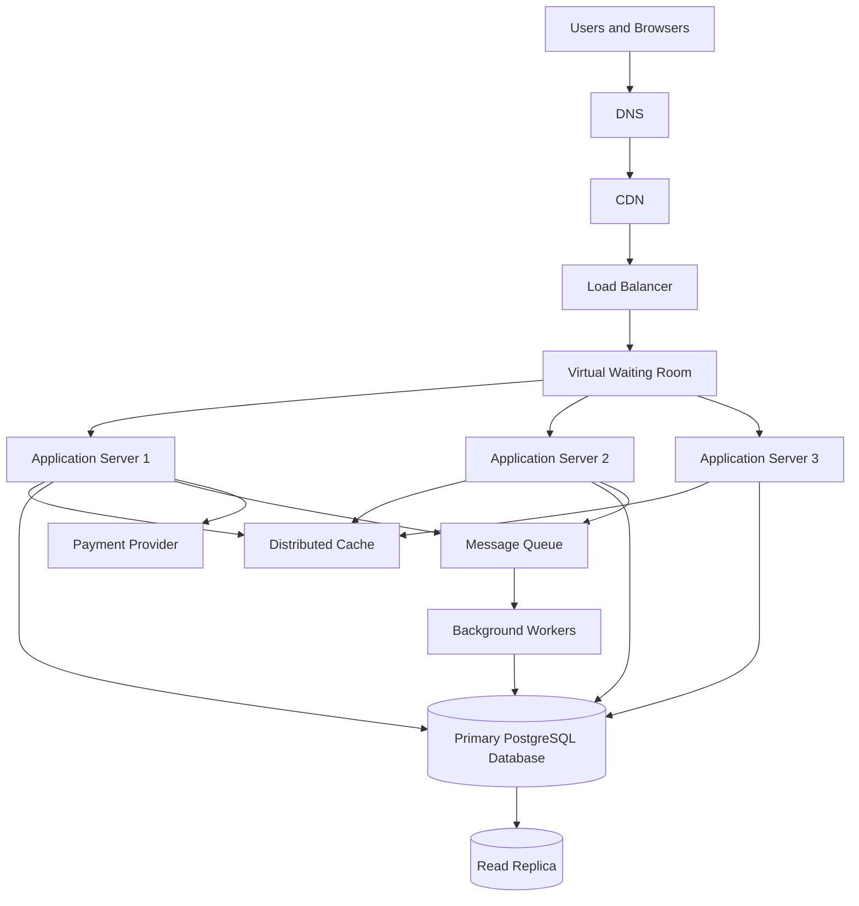

# TicketHub: Concert and Event Ticketing System Design

## 1. Requirements

TicketHub is a website where users can discover events, view seat availability, reserve seats, pay for tickets, and access their purchased tickets.

### Functional Requirements

1. Users can register, log in, and manage their accounts.
2. Users can browse events and view event details, dates, venues, and prices.
3. Users can view available seats for an event.
4. Users can temporarily hold available seats while completing checkout.
5. Users can pay for held seats and receive confirmed tickets.
6. Users can view their orders and purchased tickets.
7. The system can release expired seat holds and make those seats available again.

### Non-Functional Requirements

**Performance:** Event pages should load within two seconds under normal conditions. Seat availability and checkout responses should usually complete within 300 milliseconds, excluding external payment processing.

**Correctness:** A seat must not be sold to more than one customer. Orders should only be confirmed after successful payment verification.

**Fairness:** Users should have a fair opportunity to purchase tickets. A virtual waiting room can control entry during popular sales, and users should not be able to reserve unlimited seats.

**Availability:** Browsing should remain available during heavy traffic. If checkout becomes overloaded, the system should queue or reject excess requests safely rather than sell the same seat twice.

**Security:** Users must be authenticated to purchase tickets and must only access their own orders. Payment details should be handled by a trusted payment provider.

**Scalability:** The system should support two million registered users and handle sudden increases in traffic during popular ticket sales.

## 2. Traffic and Capacity Estimates

The system has two million registered users. On a normal day, 50,000 people visit, each viewing ten pages, and 5,000 tickets are sold.

### Normal Traffic

Page views per day:

50,000 visitors × 10 pages = 500,000 page views per day.

Average page requests per second:

500,000 ÷ 86,400 seconds ≈ 5.8 requests per second.

This estimate assumes one page view generates one primary page request. Additional API calls, images, scripts, and background requests will increase total traffic.

Tickets sold per day:

5,000 tickets per day ÷ 86,400 seconds ≈ 0.058 tickets per second on average.

Actual traffic will vary by time of day, and checkout requests will not be evenly distributed.

### Popular Concert Sale

During a popular concert sale, 200,000 people try to buy 20,000 seats within the first ten minutes.

Average arrival rate:

200,000 people ÷ 600 seconds ≈ 333 people per second.

Average seat sales required to sell all available seats within ten minutes:

20,000 seats ÷ 600 seconds ≈ 33.3 tickets per second.

The system receives approximately 333 arriving users per second during the sale, compared with about 5.8 page views per second on a normal day. The arrival rate is approximately 57 times the normal average page-request rate, although the two measures are not directly equivalent.

There are ten potential buyers for every available seat. Therefore, not everyone can receive a ticket.

### Capacity Strategy

- Serve static assets and public event information through a content delivery network (CDN).
- Add application servers behind a load balancer to distribute incoming requests.
- Use caching for event descriptions and other frequently requested data.
- Place users in a virtual waiting room during high-demand sales.
- Limit seat-hold requests and apply rate limits to prevent abuse.
- Protect database writes with transactions and constraints.
- Monitor request rates, response times, database connections, queue length, and failed payments.

## 3. API Design

The API uses REST conventions and JSON request and response bodies. Authenticated endpoints require a valid user session or access token.

| Method and endpoint | Purpose | Successful response |
|---|---|---|
| GET /events | List upcoming events | 200 OK |
| GET /events/{eventId} | View event details | 200 OK |
| GET /events/{eventId}/seats | View seat availability | 200 OK |
| POST /seat-holds | Temporarily hold available seats | 201 Created |
| POST /orders | Create an order for held seats | 201 Created |
| POST /orders/{orderId}/payment | Initiate or confirm payment through a payment provider | 202 Accepted |
| GET /me/tickets | View the authenticated user's tickets | 200 OK |

### Example: Hold Seats

Request:

```http
POST /seat-holds
Content-Type: application/json
Authorization: Bearer <access-token>
```

```json
{
  "eventId": 42,
  "seatIds": [101, 102]
}
```

Example successful response:

```json
{
  "holdId": "hold-789",
  "status": "held",
  "expiresAt": "2026-10-19T10:15:00Z"
}
```

The server must confirm that every requested seat belongs to the event and can be held before reporting success. The hold expires after a short period, such as five minutes.

### Example: Create an Order

Request:

```http
POST /orders
Content-Type: application/json
Authorization: Bearer <access-token>
```

```json
{
  "holdId": "hold-789",
  "idempotencyKey": "checkout-unique-456"
}
```

The server verifies the hold, calculates the price from trusted database records, and creates a pending order. The idempotency key helps prevent retries from creating duplicate orders.

### Error Responses

- **400 Bad Request:** Missing fields or invalid input.
- **401 Unauthorized:** The user is not authenticated.
- **403 Forbidden:** The user is not allowed to access the requested resource.
- **404 Not Found:** The event, seat, hold, or order does not exist.
- **409 Conflict:** A seat is unavailable or its hold has expired.
- **429 Too Many Requests:** The user has exceeded a rate limit.
- **500 Internal Server Error:** An unexpected server-side error occurred.

Payment notifications must be verified with the payment provider. A browser redirect alone must never be treated as proof of payment.

## 4. Data Model

TicketHub uses a relational database such as PostgreSQL because ticket sales require transactions, constraints, and reliable relationships between users, events, seats, and orders.

The main tables are `users`, `events`, `seats`, and `orders`. Two additional tables, `seat_holds` and `tickets`, support reservations and ticket ownership.

### Table 1: users

| Column | Type | Description |
|---|---|---|
| id | BIGINT PRIMARY KEY | Unique user ID |
| name | VARCHAR(100) | User's name |
| email | VARCHAR(255) UNIQUE | Login email |
| password_hash | TEXT | Securely hashed password |
| created_at | TIMESTAMP | Account creation time |

### Table 2: events

| Column | Type | Description |
|---|---|---|
| id | BIGINT PRIMARY KEY | Unique event ID |
| title | VARCHAR(200) | Event name |
| venue | VARCHAR(200) | Event location |
| starts_at | TIMESTAMP | Event start time |
| status | VARCHAR(20) | Draft, published, or cancelled |

### Table 3: seats

Each seat belongs to an event. Its status indicates whether it is available, held, or sold.

| Column | Type | Description |
|---|---|---|
| id | BIGINT PRIMARY KEY | Unique seat ID |
| event_id | BIGINT FOREIGN KEY | References events(id) |
| section | VARCHAR(50) | Seating section |
| seat_number | VARCHAR(20) | Seat label |
| status | VARCHAR(20) | Available, held, or sold |

Add a unique constraint on `(event_id, section, seat_number)` so the same seat label cannot be entered twice for one event.

### Table 4: orders

| Column | Type | Description |
|---|---|---|
| id | BIGINT PRIMARY KEY | Unique order ID |
| user_id | BIGINT FOREIGN KEY | References users(id) |
| status | VARCHAR(20) | Pending, paid, failed, or cancelled |
| total_amount | DECIMAL(10,2) | Total order price |
| payment_reference | VARCHAR(255) UNIQUE | Payment provider reference |
| created_at | TIMESTAMP | Order creation time |

### Table 5: seat_holds

| Column | Type | Description |
|---|---|---|
| id | BIGINT PRIMARY KEY | Unique hold ID |
| user_id | BIGINT FOREIGN KEY | References users(id) |
| seat_id | BIGINT FOREIGN KEY | References seats(id) |
| expires_at | TIMESTAMP | Hold expiration time |
| status | VARCHAR(20) | Active, converted, or expired |

Only one active hold should be allowed for a seat at a time. This must be enforced by database-backed locking or an equivalent atomic reservation operation, not only by application checks.

### Table 6: tickets

| Column | Type | Description |
|---|---|---|
| id | BIGINT PRIMARY KEY | Unique ticket ID |
| order_id | BIGINT FOREIGN KEY | References orders(id) |
| seat_id | BIGINT FOREIGN KEY | References seats(id) |
| ticket_code | VARCHAR(100) UNIQUE | Ticket verification code |
| created_at | TIMESTAMP | Ticket issue time |

Add a unique constraint on `tickets.seat_id` so a seat can only have one issued ticket.

### Relationships

- One user can create many orders: users to orders is one-to-many.
- One event can have many seats: events to seats is one-to-many.
- One user can create many seat holds, and a seat can have holds over time.
- One order can contain multiple tickets: orders to tickets is one-to-many.
- Each issued ticket belongs to one seat, and the unique constraint prevents multiple tickets for that seat.

## 5. Architecture and Double-Booking Prevention

### Architecture Diagram



### Component Explanations

**DNS:** Directs users to the service's public endpoint.

**CDN:** Delivers static files, such as images, stylesheets, and scripts, from locations closer to users. Public event information can also be cached when appropriate.

**Load balancer:** Distributes incoming requests across healthy application servers and removes unhealthy servers from rotation.

**Virtual waiting room:** Controls the rate at which users enter the purchase flow. It reduces sudden pressure on application servers and the database. Its queue should have a defined ordering policy and should communicate estimated waiting times carefully.

**Application servers:** Validate requests, authenticate users, enforce business rules, manage seat holds, create orders, and communicate with the database and payment provider.

**Distributed cache:** Stores frequently requested event information to reduce database reads. It is not the final authority for seat availability.

**Primary PostgreSQL database:** Stores authoritative seat, hold, order, payment-reference, and ticket records. Transactions and constraints protect ticket-sale correctness.

**Read replica:** Handles suitable read-heavy queries, such as event browsing and reporting. Seat reservations and final availability checks must use the primary database to avoid decisions based on stale replica data.

**Message queue and background workers:** Process tasks such as sending confirmation emails, generating ticket notifications, and handling payment events. Jobs should be retryable and idempotent.

**Payment provider:** Processes payments and sends verifiable payment notifications. The system issues tickets only after the payment result has been verified and the order has been safely updated.

### How Double-Booking Is Prevented

Two users might select the same seat at nearly the same time. Checking availability in application code and then updating the seat later is unsafe because both requests could see the seat as available.

TicketHub prevents this through an atomic database operation:

1. A user requests a seat hold.
2. The application begins a database transaction.
3. It attempts a conditional update on the primary database, changing the seat from `available` to `held` only if its current state still permits the reservation.
4. The database locks the affected row and serializes conflicting updates. If another user has already claimed the seat, the second update affects no rows and the request fails with `409 Conflict`.
5. The application commits the transaction only when the reservation succeeds.
6. The hold expires after a fixed time. A background worker or a later reservation request can safely release expired holds using another conditional transaction.
7. During checkout, the system validates the hold and payment result before confirming the order and issuing a ticket.
8. A unique constraint on `tickets.seat_id` provides an additional safeguard against issuing two tickets for the same seat.

For payment processing, the system must handle retries and delayed notifications safely. It should use idempotency keys and verify payment status with the provider. Expired or failed payments must not leave seats permanently held.

The database is the final authority for seat ownership. The CDN, cache, waiting room, and application servers help manage traffic but cannot independently guarantee that a seat is sold only once.

### How the System Handles the Big Sale

- The CDN serves static content without sending every request to the application.
- The waiting room limits the rate of new checkout attempts.
- Multiple application servers handle requests concurrently.
- The cache serves popular event details and other non-authoritative data.
- The primary database serializes competing seat reservations and enforces constraints.
- Read replicas support appropriate browsing queries.
- Background workers handle slower tasks outside the main checkout request.
- Monitoring and automatic scaling help operators respond to rising demand.

If all 20,000 seats are sold, later attempts return a clear sold-out or conflict response. The system must not promise a ticket to every visitor.

## 6. Trade-Offs

### Trade-Off 1: Strong Consistency vs. Performance

Using the primary database for seat reservations provides strong consistency and prevents conflicting sales. However, it can become a bottleneck during a popular sale. The waiting room, conditional updates, database indexes, and additional application servers reduce pressure, but they do not remove the database's write limit.

**Decision:** Prioritize correct seat allocation over accepting every checkout request immediately.

### Trade-Off 2: Fairness vs. Speed

A waiting room helps manage sudden traffic and provides a more orderly purchase process. However, it adds waiting time and infrastructure complexity. A strict first-in-first-out queue can be easier to explain, while randomized entry during a defined registration window may be more suitable for some events.

**Decision:** Use a documented queue policy and enforce rate limits. Communicate the policy clearly so users understand how entry is determined.

### Trade-Off 3: Caching vs. Freshness

Caching event descriptions and public details improves response times and reduces database load. However, caching seat availability can display outdated information and confuse users.

**Decision:** Cache relatively stable event information, but check seat availability and reserve seats against the primary database.

### Trade-Off 4: Synchronous vs. Asynchronous Work

Sending emails and performing other non-critical tasks during checkout can increase response time. Moving them to a message queue makes checkout faster, but adds retry handling and eventual-consistency concerns.

**Decision:** Keep seat reservation and order correctness in the transactional path. Process notifications and other suitable tasks asynchronously.

## Conclusion

TicketHub must handle normal browsing efficiently while remaining correct and fair during high-demand ticket sales. Horizontal scaling, a CDN, caching, a waiting room, and background workers help manage traffic. The most important safeguard is the primary database's atomic reservation logic, supported by transactions and unique constraints. This ensures that competition for a limited number of seats does not result in double-booking.
